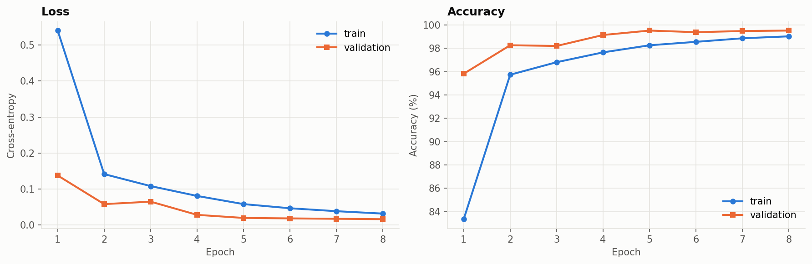
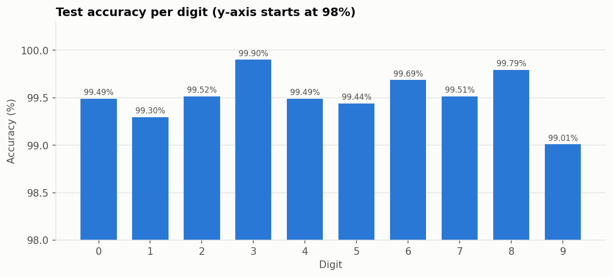
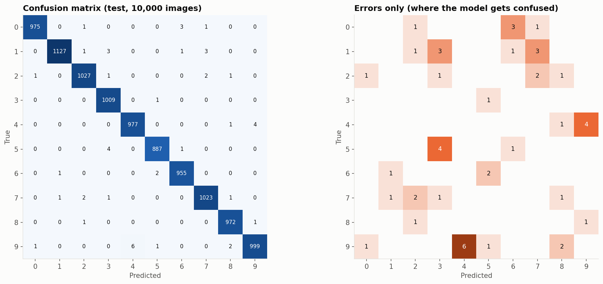
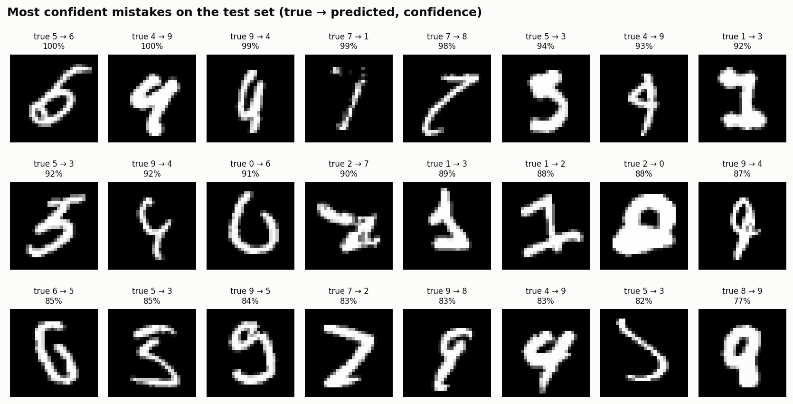

# Handwritten Digit Recognizer

A convolutional neural network trained on MNIST, plus a web app where you **draw a digit and the
model predicts it live** as you draw.

**Skills shown:** deep learning · CNNs · PyTorch training loop · data augmentation ·
image preprocessing · model evaluation · interactive ML demo

**Stack:** Python · PyTorch · torchvision · Gradio · NumPy · Matplotlib

<!-- After recording a short demo, add it here, e.g.:

-->

---

## Results

**Test accuracy: 99.51%** on the 10,000 MNIST test images, only **49 mistakes**, with a
468k-parameter CNN trained for 8 epochs on a laptop. Full numbers: [`reports/RESULTS.md`](reports/RESULTS.md).

| Digit | 0 | 1 | 2 | 3 | 4 | 5 | 6 | 7 | 8 | 9 |
|---|---:|---:|---:|---:|---:|---:|---:|---:|---:|---:|
| Accuracy | 99.49% | 99.30% | 99.52% | 99.90% | 99.49% | 99.44% | 99.69% | 99.51% | 99.79% | 99.01% |

**Key findings**

- **Every digit is above 99%.** The easiest is **3** (99.90%); the hardest is **9** (99.01%).
- **Most mistakes come from look-alike pairs:** 9 read as 4 (6 times), 4 read as 9 (4), 5 read as 3 (4),
  1 read as 7 (3). These are digits that differ by one stroke, such as an open or closed top on a 4 or 9.
- **Many "mistakes" are ambiguous even to a human.** The most confident errors (bottom figure) include
  badly cropped, very thin or unusually written digits.
- **No overfitting.** Validation loss keeps falling until the last epoch. Validation accuracy is *higher*
  than training accuracy because augmentation and dropout are only applied during training, which makes
  the training images harder than the clean validation images.

| Training curves | Per-digit accuracy |
|---|---|
|  |  |





## How it works

### 1. The model

A compact CNN (~470k parameters):

```
input 1×28×28
→ conv 3×3 (32) → BN → ReLU → conv 3×3 (32) → BN → ReLU → max-pool → 32×14×14
→ conv 3×3 (64) → BN → ReLU → conv 3×3 (64) → BN → ReLU → max-pool → 64×7×7
→ flatten → dense 128 → ReLU → dropout 0.3 → dense 10
```

- **Batch normalization** stabilises and speeds up training; **dropout** reduces overfitting.
- **Optimizer:** AdamW with a **one-cycle** learning-rate schedule, 8 epochs, batch size 128.
- **Data:** 55,000 training images (augmented) / 5,000 validation (used to keep the best checkpoint) /
  10,000 test images, touched only once at the end.

### 2. Data augmentation

Each training image gets a random rotation (±10°), shift (±10%) and zoom (90–110%). MNIST digits are
neatly centred; digits drawn in a browser are not, so augmentation makes the live demo much more robust.

### 3. Making canvas drawings look like MNIST

This step matters as much as the model. A canvas drawing is black-on-white, any size, anywhere on the
canvas, while MNIST digits are white-on-black, fit in a 20×20 box and are centred by their centre of
mass in a 28×28 frame. Before predicting, the app reproduces the original MNIST preprocessing:

**invert → crop to the ink → resize the longest side to 20 px → paste into 28×28 → shift the centre of mass to the middle**

The app shows the resulting 28×28 image next to the prediction, so you can see exactly what the model sees.

## Project structure

```
digit-recognizer/
├── train.py               # train, evaluate on the test set, write reports/
├── app.py                 # Gradio drawing app
├── src/digits/
│   ├── model.py           # the CNN
│   ├── data.py            # MNIST loaders + augmentation
│   ├── engine.py          # training / evaluation loops, device selection
│   ├── preprocess.py      # canvas drawing → MNIST-style 28×28
│   ├── inference.py       # load checkpoint, predict
│   └── plots.py           # report figures
├── models/mnist_cnn.pt    # trained weights (committed, ~2 MB)
├── reports/               # metrics.json, history.csv, RESULTS.md, figures/
├── tests/test_digits.py
└── data/                  # MNIST download (git-ignored)
```

## Quick start

Requires Python 3.10+. Run each command separately, from the project folder.

**1. Create and activate a virtual environment** (on Windows the second line is `.venv\Scripts\activate`)
```bash
python -m venv .venv
source .venv/bin/activate
```

**2. Install dependencies**
```bash
pip install -r requirements.txt
```

**3. Run the tests** (checks the setup in a few seconds)
```bash
pytest -q
```

**4. Train the model** (downloads MNIST automatically; about 5–10 minutes on a laptop)
```bash
python train.py
```

**5. Launch the drawing app**, then open http://127.0.0.1:7860 in your browser
```bash
python app.py
```

Press **Ctrl+C** in the terminal to stop the app.

### Options

| Command | What it does |
|---|---|
| `python train.py --epochs 3` | quicker training run |
| `python train.py --device cpu` | force CPU (default picks CUDA, then Apple GPU, then CPU) |
| `python train.py --eval-only` | skip training: re-evaluate the saved model and redraw the report |
| `python app.py --share` | also creates a temporary public link you can send to someone |

## Put the demo online

Hugging Face Spaces can host the app permanently:

1. Create an account at huggingface.co, then **New → Space**. Choose **Gradio** as the SDK and the free CPU.
2. Upload `app.py`, `requirements.txt`, the `src/` folder and `models/mnist_cnn.pt`, keeping the same folder layout.
3. The Space builds and gives you a public link. Add it to the top of this README.

## Limitations & next steps

- MNIST digits come from US Census employees and students; other handwriting styles can be harder.
- The app expects **one** digit; multiple digits would need a segmentation step first.
- Ideas: train on EMNIST for letters, export to ONNX to run in the browser, or compare with a small Vision Transformer.

## Data

MNIST: LeCun, Y., Cortes, C., & Burges, C. J. C. *The MNIST database of handwritten digits.*
Downloaded automatically through `torchvision.datasets.MNIST`.
